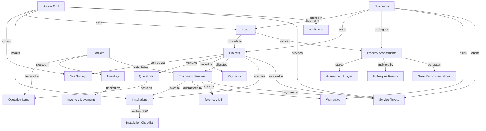

# SolarOS Database Entity-Relationship Diagram

This document contains the complete entity-relationship architecture for SolarOS rendered in GitHub-compatible Mermaid format.

---

## 1. High-Level Entity Flow

---

## 2. Complete Entity-Relationship Diagram (Mermaid)

```mermaid
erDiagram
    users ||--o{ leads : "assigned_salesperson"
    users ||--o{ site_surveys : "surveyor"
    users ||--o{ site_surveys : "approved_by"
    users ||--o{ installations : "assigned_technician"
    users ||--o{ installation_checklist : "completed_by"
    users ||--o{ service_tickets : "assigned_technician"
    users ||--o{ inventory_movements : "performed_by"
    users ||--o{ audit_logs : "actor"

    customers ||--o{ leads : "submits"
    customers ||--o{ projects : "contracts"
    customers ||--o{ property_assessments : "owns_site"
    customers ||--o{ quotations : "receives"
    customers ||--o{ warranties : "holds"
    customers ||--o{ service_tickets : "files"

    leads ||--o{ projects : "originates"
    leads ||--o{ property_assessments : "attaches"

    projects ||--o{ property_assessments : "specifies"
    projects ||--o{ site_surveys : "undergoes"
    projects ||--o{ solar_recommendations : "sizes"
    projects ||--o{ quotations : "prices"
    projects ||--o{ payments : "receives"
    projects ||--o{ equipment : "allocates"
    projects ||--o{ installations : "executes"
    projects ||--o{ service_tickets : "maintains"

    property_assessments ||--o{ assessment_images : "contains"
    property_assessments ||--o{ ai_analysis_results : "evaluated_by"
    property_assessments ||--o{ solar_recommendations : "generates"
    property_assessments ||--o{ site_surveys : "ground_truth_for"

    quotations ||--o{ quotation_items : "itemizes"
    quotations ||--o{ payments : "bills"

    products ||--o{ quotation_items : "quoted_as"
    products ||--o{ inventory : "stocked_as"
    products ||--o{ inventory_movements : "tracks"
    products ||--o{ equipment : "manufactures"

    inventory ||--o{ inventory_movements : "logs"

    installations ||--o{ installation_checklist : "verifies_sop"
    installations ||--o{ equipment : "installs_hardware"

    equipment ||--o{ warranties : "guaranteed_under"
    equipment ||--o{ telemetry : "emits_readings"
    equipment ||--o{ service_tickets : "serviced_in"

    users {
        uuid id PK
        uuid auth_user_id UK
        varchar full_name
        varchar email UK
        varchar phone
        varchar role
        boolean is_active
        timestamptz created_at
        timestamptz updated_at
    }

    customers {
        uuid id PK
        varchar full_name
        varchar email
        varchar phone
        varchar alternate_phone
        text property_address
        varchar city
        varchar state
        varchar postal_code
        numeric latitude
        numeric longitude
        varchar property_type
        text notes
        timestamptz created_at
        timestamptz updated_at
    }

    leads {
        uuid id PK
        varchar lead_number UK
        uuid customer_id FK
        varchar source
        numeric monthly_electricity_bill
        numeric monthly_consumption_kwh
        numeric estimated_system_capacity_kw
        varchar status
        uuid assigned_salesperson_id FK
        text notes
        timestamptz created_at
        timestamptz updated_at
    }

    projects {
        uuid id PK
        varchar project_number UK
        uuid customer_id FK
        uuid lead_id FK
        varchar project_name
        numeric proposed_capacity_kw
        numeric approved_capacity_kw
        varchar project_status
        numeric estimated_cost
        numeric final_cost
        date expected_completion_date
        date actual_completion_date
        timestamptz created_at
        timestamptz updated_at
    }

    property_assessments {
        uuid id PK
        uuid customer_id FK
        uuid lead_id FK
        uuid project_id FK
        text property_address
        varchar city
        varchar state
        varchar postal_code
        numeric latitude
        numeric longitude
        numeric roof_length
        numeric roof_width
        numeric roof_area
        numeric usable_roof_area
        varchar measurement_unit
        varchar roof_type
        varchar roof_orientation
        numeric roof_tilt
        integer number_of_roof_sections
        boolean grid_availability
        numeric monthly_bill
        numeric monthly_consumption_kwh
        varchar connection_phase
        varchar preferred_solar_type
        numeric budget
        varchar assessment_status
        timestamptz created_at
        timestamptz updated_at
    }

    assessment_images {
        uuid id PK
        uuid assessment_id FK
        text file_path
        varchar file_name
        varchar mime_type
        bigint file_size_bytes
        varchar image_type
        timestamptz uploaded_at
    }

    ai_analysis_results {
        uuid id PK
        uuid assessment_id FK
        varchar model_name
        varchar model_version
        varchar analysis_status
        jsonb detected_obstacles
        jsonb detected_shading_regions
        numeric estimated_usable_area
        jsonb proposed_panel_layout
        numeric confidence
        jsonb missing_information
        jsonb raw_result_json
        timestamptz created_at
    }

    site_surveys {
        uuid id PK
        uuid project_id FK
        uuid assessment_id FK
        uuid surveyor_id FK
        timestamptz scheduled_date
        timestamptz actual_survey_date
        numeric verified_roof_area
        varchar verified_roof_orientation
        numeric verified_roof_tilt
        text structural_observations
        text shading_observations
        numeric cable_distance
        text electrical_observations
        text safety_observations
        varchar approval_status
        text rejection_reason
        uuid approved_by FK
        timestamptz approved_at
        text remarks
        timestamptz created_at
        timestamptz updated_at
    }

    products {
        uuid id PK
        varchar sku UK
        varchar product_name
        varchar brand
        varchar model
        varchar category
        numeric rated_power_w
        numeric voltage
        numeric current
        jsonb technical_specifications
        numeric purchase_price
        numeric selling_price
        integer warranty_months
        boolean is_active
        timestamptz created_at
        timestamptz updated_at
    }

    solar_recommendations {
        uuid id PK
        uuid assessment_id FK
        uuid project_id FK
        numeric system_capacity_kw
        numeric estimated_generation_kwh
        numeric estimated_monthly_savings
        numeric estimated_payback_years
        varchar recommendation_source
        jsonb assumptions
        jsonb warnings
        jsonb configuration
        jsonb bom
        varchar approval_status
        timestamptz created_at
        timestamptz updated_at
    }

    quotations {
        uuid id PK
        varchar quotation_number UK
        uuid project_id FK
        uuid customer_id FK
        numeric system_capacity_kw
        numeric subtotal
        numeric discount
        numeric gst_amount
        numeric installation_charges
        numeric total_amount
        varchar quotation_status
        date valid_until
        timestamptz approved_at
        timestamptz created_at
        timestamptz updated_at
    }

    quotation_items {
        uuid id PK
        uuid quotation_id FK
        uuid product_id FK
        text description
        numeric quantity
        numeric unit_price
        numeric total_price
    }

    payments {
        uuid id PK
        uuid project_id FK
        uuid quotation_id FK
        numeric amount
        varchar payment_method
        varchar transaction_reference
        varchar payment_status
        timestamptz payment_date
        timestamptz created_at
    }

    inventory {
        uuid id PK
        uuid product_id FK
        varchar warehouse_name
        numeric quantity_on_hand
        numeric quantity_reserved
        numeric reorder_level
        timestamptz updated_at
    }

    inventory_movements {
        uuid id PK
        uuid product_id FK
        uuid inventory_id FK
        varchar movement_type
        numeric quantity
        varchar reference_type
        uuid reference_id
        uuid performed_by FK
        text notes
        timestamptz created_at
    }

    equipment {
        uuid id PK
        uuid product_id FK
        varchar serial_number UK
        varchar supplier
        date purchase_date
        date warranty_start_date
        date warranty_end_date
        varchar equipment_status
        uuid project_id FK
        uuid installation_id FK
        timestamptz created_at
        timestamptz updated_at
    }

    installations {
        uuid id PK
        uuid project_id FK
        varchar installation_number UK
        uuid assigned_technician_id FK
        timestamptz scheduled_date
        timestamptz start_time
        timestamptz completion_time
        varchar installation_status
        numeric progress_percentage
        numeric system_capacity_kw
        jsonb testing_results
        boolean customer_confirmation
        timestamptz created_at
        timestamptz updated_at
    }

    installation_checklist {
        uuid id PK
        uuid installation_id FK
        varchar task_name
        boolean is_completed
        uuid completed_by FK
        timestamptz completed_at
        text remarks
    }

    warranties {
        uuid id PK
        uuid equipment_id FK
        uuid customer_id FK
        date warranty_start_date
        date warranty_end_date
        varchar warranty_status
        text warranty_document_path
        timestamptz created_at
    }

    telemetry {
        uuid id PK
        uuid equipment_id FK
        timestamptz timestamp
        numeric voltage
        numeric current
        numeric power
        numeric temperature
        numeric energy_generated_kwh
        varchar source
    }

    service_tickets {
        uuid id PK
        varchar ticket_number UK
        uuid customer_id FK
        uuid project_id FK
        uuid equipment_id FK
        text issue_description
        varchar issue_category
        varchar priority
        uuid assigned_technician_id FK
        varchar ticket_status
        text resolution_notes
        timestamptz created_at
        timestamptz resolved_at
    }

    audit_logs {
        uuid id PK
        uuid user_id FK
        varchar action
        varchar entity_type
        uuid entity_id
        jsonb metadata
        timestamptz created_at
    }
```

